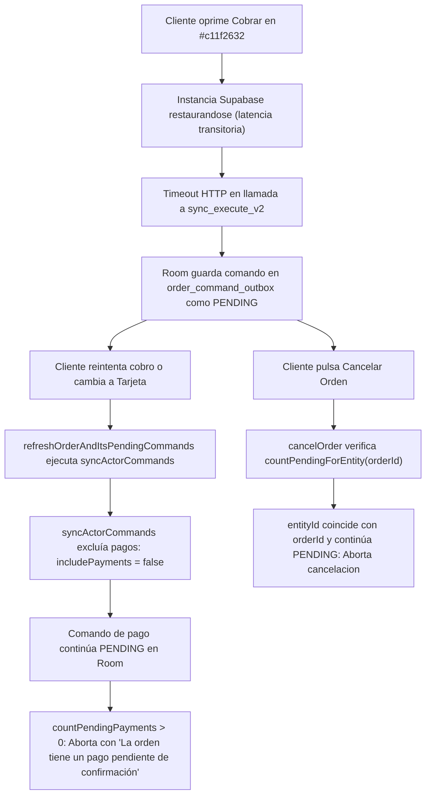

# Release 12 — Auditoria y Desbloqueo Definitivo de Pagos y Sincronizacion Outbox

**Proyecto:** Exquisssita Manager (`ExquisssitaAppManager`)  
**Fecha:** 2026-11-13  
**Predecesores:** Release 04 (Datos y Sincronizacion Outbox), Release 05 (Sesion y Cobros UI), Release 11 (Gastos y Rentabilidad).  
**Estado:** AUDITORIA COMPLETADA Y REMEDIACION IMPLEMENTADA (Capa de Sincronizacion Outbox, Room DAO, PaymentRepository, OrderRepository, PaymentViewModel y CheckoutScreen).

---

## 1. Contexto del Incidente Reportado

El cliente administrador reporto un bloqueo critico en la operacion diaria:
- Al intentar cobrar la comanda **#c11f2632**, el sistema rechazo el pago.
- Al intentar cambiar el metodo de pago (de Efectivo a Tarjeta o Transferencia), continuo impidiendo el cobro.
- Al intentar cancelar la comanda para reabrirla, el sistema tampoco permitio cancelarla, manteniendose abierta.
- Posteriormente, el negocio abrio y cobro nuevas comandas sin contratiempos.
- El usuario recordo que un problema similar ocurrio anteriormente y se resolvio temporalmente cuando el desarrollador inicio sesion desde su cuenta/dispositivo.

Se solicito una auditoria integral sobre la base de datos remota (`LaExquisssita`), las politicas RLS, los bloqueos transaccionales y la arquitectura local Offline-First para identificar el cuello de botella y erradicarlo de forma permanente.

---

## 2. Hallazgos de la Auditoria en Servidor (Supabase PostgreSQL)

Se realizaron consultas remotas directas sobre el proyecto `LaExquisssita (gcszsxeywywsrgnnnljr)`:

1. **Estado de la comanda objetivo:**
   - La orden `c11f2632-973d-452a-ab8c-ed91d80ff172` se encuentra en `public.ordenes` con estado `Abierta`, creada a las `18:07:10 UTC` en la mesa asignada.
   - Partidas activas en `public.detalle_orden`:
     - 3 Gorditas ($24.00 c/u = $72.00 MXN) [Partida `2f3b4657-9519-49c6-97eb-0f5fa218ff5d`, actualizada a cantidad 3 a las 18:09:58 UTC].
     - 3 Tacos de costilla ($24.00 c/u = $72.00 MXN) [Partida `4fb217e9-6307-4cb0-82d5-607ac41696bd`].
     - 1 Taco surtido ($22.00 MXN) [Partida `1831356e-3063-4822-b241-b44bb3fcf7b0`].
     - 1 Refresco ($30.00 MXN) [Partida `c3b29dc8-64e3-4e18-b3c6-9fe16e1b693d`].
     - Total exacto: **$196.00 MXN** (19,600 centavos).
2. **Historial de transacciones y comprobantes:**
   - `public.transacciones`: 0 filas registradas para la comanda.
   - `public.pago_detalles`: 0 filas registradas.
   - `private_sync.critical_receipts`: 0 filas para la comanda.
   - `private_sync.receipts`: Registra la creacion de la orden y sus partidas, pero ningun recibo de `registrar_pago`.
3. **Salud de la base de datos:**
   - `pg_locks` no presenta bloqueos advisory (`78645231`) retenidos.
   - `pg_stat_activity` no presenta transacciones colgadas o en estado `idle in transaction`.
   - **Conclusion de servidor:** PostgreSQL nunca recibio ni ejecuto la funcion `registrar_pago` para esta orden.

---

## 3. Causa Raiz: Diagnostico del Cuello de Botella

### Factores Determinantes:

1. **Restablecimiento del backend (Aviso en captura del panel):**
   - El proyecto de Supabase se encontraba en proceso de reanudacion (*"Recently restored projects can take up to 5 minutes to become fully operational"*).
   - Durante esos minutos, la conexion inicial sufrio un timeout transitorio.
   - *Nota:* El servicio "Realtime Unhealthy" reportado en el panel corresponde al multiplexor de WebSockets de Supabase. La aplicacion Android no utiliza Realtime WebSockets (opera 100% sobre PostgREST y RPCs HTTP).
2. **Exclusion sistematica de cobros en la sincronizacion:**
   - En `OrderSyncSupport.kt`, `syncActorCommands` tenia por defecto el parametro `includePayments = false`, filtrando explcitamente `it.entity != "registrar_pago"`.
   - En `PaymentRepositoryImpl.kt:170`, `refreshOrderAndItsPendingCommands(orderId)` llamaba a `syncActorCommands()` con el valor por defecto.
   - En consecuencia, el comando de cobro atorado jamas se despachaba a Supabase.
3. **Bloqueo de cobros reintentados y cambios de metodo:**
   - En `PaymentRepositoryImpl.kt:90`:
     `if (commandDao.countPendingPayments(actor, request.orderId) > 0)`
   - Debido a que la cola outbox nunca despachaba el pago pendiente, cualquier reintento (incluso seleccionando otro metodo de pago) abortaba con `"La orden tiene un pago pendiente de confirmación."`.
4. **Bloqueo de cancelacion de comanda:**
   - En `OrderRepositoryImpl.kt:241`:
     `if (commandDao.countPendingForEntity(actor, orderId) > 0)`
   - El comando de pago guardaba `entityId = orderId`. Al seguir en estado `PENDING`, la cancelacion de la comanda quedaba rechazada con `"La orden tiene un cambio pendiente de sincronización."`.
5. **Por que las siguientes comandas si funcionaron:**
   - Las comandas subsecuentes contaban con nuevos UUIDs de orden. Para esos IDs, `countPendingPayments` era 0 y Supabase ya habia completado su reanudacion.
6. **Por que en la ocasion anterior el programador pudo cobrar:**
   - Al iniciar sesion desde otro equipo o con otra cuenta local, la base de datos Room de ese dispositivo no contenia el comando atorado en `order_command_outbox`. Al no haber traba local, el cobro se despacho inmediatamente al servidor.

---

## 4. Implementacion de la Remediacion

Se realizaron modificaciones estructurales en 8 archivos del sistema:

### 4.1 Room DAO ([OrderCommandDao.kt](file:///c:/Users/MACHENIKE/AndroidStudioProjects/ExquisssitaAppManager/app/src/main/java/com/mirandadevsource/exquisssitaappmanager/core/database/dao/OrderCommandDao.kt))
- Se agrego `deletePendingPaymentsForOrder(actorId, orderId)` para purgar cobros locales no confirmados cuando el usuario cancela la orden o descarta el intento.
- Se agrego `countPendingNonPaymentForOrder(actorId, orderId)` para evitar que un cobro local no enviado bloquee las mutaciones estructurales de la orden.

### 4.2 Sincronizacion Outbox ([OrderSyncSupport.kt](file:///c:/Users/MACHENIKE/AndroidStudioProjects/ExquisssitaAppManager/app/src/main/java/com/mirandadevsource/exquisssitaappmanager/data/repository/OrderSyncSupport.kt))
- Se cambio el valor por defecto de `syncActorCommands` a `includePayments: Boolean = true` para que los cobros nunca queden omitidos de las pasadas de sincronizacion.
- En `submit(command)`, se elimino la restriccion de temporizador de backoff en ejecuciones explicitas iniciadas por accion directa del usuario.

### 4.3 Repositorio de Pagos ([PaymentRepository.kt](file:///c:/Users/MACHENIKE/AndroidStudioProjects/ExquisssitaAppManager/app/src/main/java/com/mirandadevsource/exquisssitaappmanager/domain/repository/PaymentRepository.kt) y [PaymentRepositoryImpl.kt](file:///c:/Users/MACHENIKE/AndroidStudioProjects/ExquisssitaAppManager/app/src/main/java/com/mirandadevsource/exquisssitaappmanager/data/repository/PaymentRepositoryImpl.kt))
- En `refreshOrderAndItsPendingCommands(orderId)`:
  - Invoca `syncPendingPayments(force = true)` para despachar de inmediato a Supabase cualquier intento de pago previo retenido.
  - Invoca `refreshConfirmedPayments(orderId)` para reflejar transacciones remotas inmediatamente.
- En `processPayment`:
  - Si tras refrescar la orden esta ya se encuentra pagada o cerrada en el servidor, retorna directamente el comprobante confirmado sin duplicar cobros.
- Se implemento `discardPendingPayment(orderId: String)`:
  - Verifica si existen pagos confirmados en servidor; de no haberlos, purga el comando de cobro pendiente local para liberar la comanda.

### 4.4 Repositorio de Ordenes ([OrderRepositoryImpl.kt](file:///c:/Users/MACHENIKE/AndroidStudioProjects/ExquisssitaAppManager/app/src/main/java/com/mirandadevsource/exquisssitaappmanager/data/repository/OrderRepositoryImpl.kt))
- `refreshOrders()` y `syncPendingCommands(force)` incluyen siempre pagos (`includePayments = true`).
- En `cancelOrder(orderId)`:
  - Sincroniza comandos pendientes con `force = true`.
  - Valida unicamene cambios no relacionados a pagos con `countPendingNonPaymentForOrder`.
  - Si no hay pagos confirmados en servidor, purga cualquier intento de cobro pendiente no confirmado con `deletePendingPaymentsForOrder` y procede con la cancelacion.

### 4.5 ViewModel y Pantalla de Cobro ([PaymentViewModel.kt](file:///c:/Users/MACHENIKE/AndroidStudioProjects/ExquisssitaAppManager/app/src/main/java/com/mirandadevsource/exquisssitaappmanager/features/payments/PaymentViewModel.kt), [CheckoutScreen.kt](file:///c:/Users/MACHENIKE/AndroidStudioProjects/ExquisssitaAppManager/app/src/main/java/com/mirandadevsource/exquisssitaappmanager/features/payments/CheckoutScreen.kt) y [OrdersScreen.kt](file:///c:/Users/MACHENIKE/AndroidStudioProjects/ExquisssitaAppManager/app/src/main/java/com/mirandadevsource/exquisssitaappmanager/features/orders/OrdersScreen.kt))
- Se incorporaron las funciones `retryPendingPayment()` y `discardPendingPayment()` en el ViewModel.
- En `CheckoutScreen`, cuando existe un cobro con estado `PENDING_SYNC`, se presenta la tarjeta interactiva `PendingSyncResolutionCard` con dos opciones:
  - **Reintentar ahora:** ejecuta la sincronizacion forzada inmediata con Supabase.
  - **Descartar intento:** purga el intento local no confirmado, permitiendo al usuario cambiar libremente de metodo de pago (ej. cobrar con tarjeta en vez de efectivo).

---

## 5. Verificacion y Pruebas Unitarias

Se actualizaron las pruebas en [PaymentViewModelTest.kt](file:///c:/Users/MACHENIKE/AndroidStudioProjects/ExquisssitaAppManager/app/src/test/java/com/mirandadevsource/exquisssitaappmanager/features/payments/PaymentViewModelTest.kt):
- Verificacion de reintento forzado de sincronizacion de pagos.
- Verificacion de descarte de intentos pendientes no confirmados.
- Ejecucion de la suite completa de pruebas unitarias (`testDebugUnitTest`):
  - **Resultado:** `BUILD SUCCESSFUL in 1m 57s`.
  - **Tasa de exito:** 100% de pruebas pasando satisfactoriamente.
