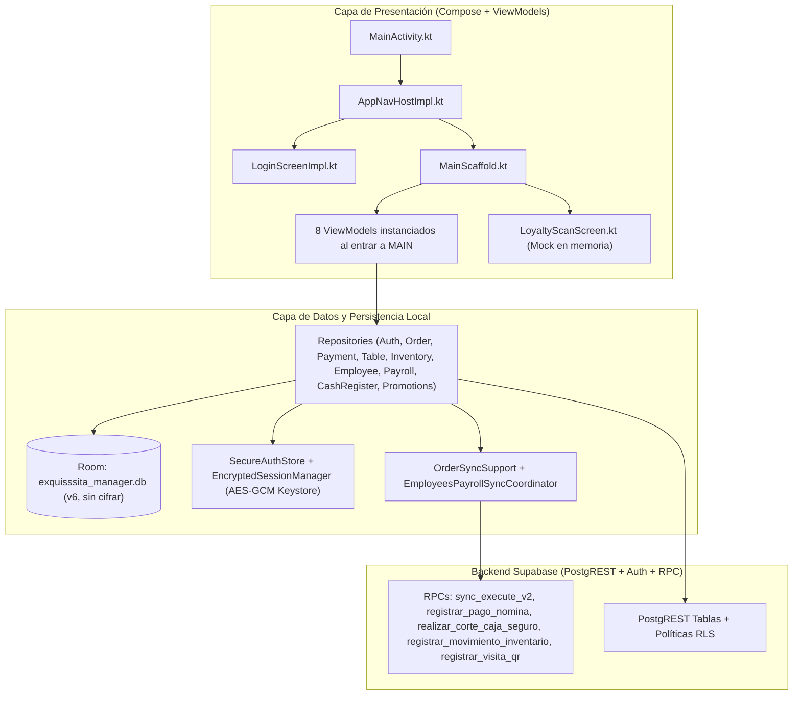

# Auditoría Integral del Proyecto — ExquisssitaAppManager

Este informe consolida la revisión estática profunda de **Capa de Datos (`core/`, `data/`, `domain/`)**, **Capa de UI y ViewModels (`features/`, `navigation/`, `MainActivity.kt`)** y **Seguridad, Credenciales y Backend (`supabase/migrations/`, `supabase/config.toml`, configuración Android)**.

---

## Arquitectura Actual y Flujo Auditado

---

## 1. Hallazgos Críticos y Altos en Seguridad, Sesiones y Credenciales

> [!CAUTION]
> Existen brechas en el aislamiento de sesión local, permisos SQL residuales en tablas de clientes/empleados y falta de validación de precios en servidor que deben corregirse antes de operar en producción.

### SEC-01 (Crítica) — Fuga de sesión tras `signOut` en el historial de navegación y retención de datos sensibles en memoria/Room
* **Evidencia**:
  * [AppNavHostImpl.kt](file:///c:/Users/MACHENIKE/AndroidStudioProjects/ExquisssitaAppManager/app/src/main/java/com/mirandadevsource/exquisssitaappmanager/navigation/AppNavHostImpl.kt#L50-L65)
  * [MainScaffold.kt](file:///c:/Users/MACHENIKE/AndroidStudioProjects/ExquisssitaAppManager/app/src/main/java/com/mirandadevsource/exquisssitaappmanager/features/main/MainScaffold.kt#L153-L170)
  * [AuthRepositoryImpl.kt](file:///c:/Users/MACHENIKE/AndroidStudioProjects/ExquisssitaAppManager/app/src/main/java/com/mirandadevsource/exquisssitaappmanager/data/repository/AuthRepositoryImpl.kt#L216-L220)
  * [EmployeesPayrollSyncCoordinator.kt](file:///c:/Users/MACHENIKE/AndroidStudioProjects/ExquisssitaAppManager/app/src/main/java/com/mirandadevsource/exquisssitaappmanager/data/sync/EmployeesPayrollSyncCoordinator.kt#L18-L68)
* **Detalle técnico**:
  1. **Pila de navegación mal limpiada al cerrar sesión**: Al iniciar sesión (`SIGNED_IN`), se navega a `AppRoutes.MAIN` haciendo `popUpTo(AppRoutes.LOGIN) { inclusive = true }`. Cuando el usuario cierra sesión (`SIGNED_OUT` en líneas 50–56), se ejecuta `navController.navigate(AppRoutes.LOGIN) { popUpTo(AppRoutes.LOGIN) { inclusive = true } }`. Como `LOGIN` ya no estaba en el backstack, **`AppRoutes.MAIN` no se elimina de la pila** y queda debajo de `LOGIN`. Presionar el botón físico "Atrás" permite regresar a `MainScaffold` con los ViewModels vivos en memoria.
  2. **Instanciación prematura de todos los ViewModels**: En `MainScaffold.kt:162-169`, los 8 ViewModels (`employeesViewModel`, `payrollViewModel`, `inventoryViewModel`, `promotionsViewModel`, `tablesViewModel`, `ordersViewModel`, `cashRegisterViewModel`, `dashboardViewModel`) se instancian incondicionalmente en cuanto se compone `MainScaffold`.
  3. **Falta de limpieza y aislamiento por usuario (`actorUserId`) en Room**: `clearLocalSession()` (`AuthRepositoryImpl.kt:216-220`) borra el token en `SecureAuthStore`, pero no limpia las cachés sensibles de `AppDatabase` (`employee_cache`, `payroll_record_cache`, `transaction_cache`, `cash_cut_cache`). Peor aún, las colas `employee_cache` ([EmployeeEntity.kt](file:///c:/Users/MACHENIKE/AndroidStudioProjects/ExquisssitaAppManager/app/src/main/java/com/mirandadevsource/exquisssitaappmanager/core/database/local/entities/EmployeeEntity.kt#L11-L28)) y `payroll_payment_intents` ([PayrollPaymentIntentEntity.kt](file:///c:/Users/MACHENIKE/AndroidStudioProjects/ExquisssitaAppManager/app/src/main/java/com/mirandadevsource/exquisssitaappmanager/core/database/local/entities/PayrollPaymentIntentEntity.kt#L12-L26)) **no almacenan `actorUserId`**. Si el Usuario A deja cambios de salario o pagos de nómina pendientes offline y cierra sesión, cuando el Usuario B inicie sesión en la misma tablet y abra Empleados/Nómina, `EmployeesPayrollSyncCoordinator` enviará las operaciones de A firmadas con la sesión y autoría (`registrado_por`) de B.

### SEC-02 (Crítica) — Permisos excesivos (`GRANT ALL` con `TRUNCATE` y `UPDATE` irrestricto de columnas) en `public.clientes`
* **Evidencia**:
  * [20261002204457_remote_baseline.sql](file:///c:/Users/MACHENIKE/AndroidStudioProjects/ExquisssitaAppManager/supabase/migrations/20261002204457_remote_baseline.sql#L451-L475) y [línea 675](file:///c:/Users/MACHENIKE/AndroidStudioProjects/ExquisssitaAppManager/supabase/migrations/20261002204457_remote_baseline.sql#L675)
  * [20261003030433_phase8_qr_loyalty_daily_visit.sql](file:///c:/Users/MACHENIKE/AndroidStudioProjects/ExquisssitaAppManager/supabase/migrations/20261003030433_phase8_qr_loyalty_daily_visit.sql#L3-L8)
* **Detalle técnico**:
  1. A diferencia de las demás tablas operativas cuyos privilegios fueron endurecidos en migraciones posteriores, `public.clientes` conserva el `GRANT DELETE, INSERT, MAINTAIN, REFERENCES, SELECT, TRIGGER, TRUNCATE, UPDATE ON TABLE "public"."clientes" TO "anon", "authenticated"` del baseline (`línea 675`). En PostgreSQL, `TRUNCATE` no pasa por políticas RLS de fila.
  2. La política `clientes_update_own` (`líneas 471-475`) permite a cualquier cliente autenticado hacer `UPDATE` sobre su propia fila (`auth.uid() = user_id`) sin restricción de columnas. Cualquier cliente con sesión válida puede ejecutar `PATCH /rest/v1/clientes` y asignarse arbitrariamente `puntos_lealtad = 999999` y `visitas_totales = 999999`.
  3. El trigger `sync_capture` ([20261003062018_bidirectional_sync_contract.sql](file:///c:/Users/MACHENIKE/AndroidStudioProjects/ExquisssitaAppManager/supabase/migrations/20261003062018_bidirectional_sync_contract.sql#L63-L82)) serializa `to_jsonb(new)` completo en `private_sync.changes.data`, exponiendo `qr_token_hash` a través de `sync_pull`.

### SEC-03 (Alta) — Escalada horizontal y auto-aumento de salario por rol `'gerente'` en `public.empleados`
* **Evidencia**:
  * [20261010195445_payroll_manager_employee_access.sql](file:///c:/Users/MACHENIKE/AndroidStudioProjects/ExquisssitaAppManager/supabase/migrations/20261010195445_payroll_manager_employee_access.sql#L104-L119)
  * [20261010200756_reject_missing_roles_for_sensitive_actions.sql](file:///c:/Users/MACHENIKE/AndroidStudioProjects/ExquisssitaAppManager/supabase/migrations/20261010200756_reject_missing_roles_for_sensitive_actions.sql#L12-L26)
* **Detalle técnico**:
  * La política `empleados_admin_manager_manage` y el `GRANT UPDATE (nombre, apellido, telefono, salario, dia_pago, activo)` permiten a cualquier usuario con rol `'gerente'` modificar todas las filas de `public.empleados`, incluido su propio registro y el de otros gerentes.
  * Un `'gerente'` puede incrementar su propio `salario` mediante un `UPDATE` directo y enseguida invocar `registrar_pago_nomina` (cuyo historial es append-only), o poner `activo = false` a otros gerentes (`user_id IS NOT NULL`), revocándoles el acceso inmediato a la app dado que `public.auth_role()` verifica `e.activo IS TRUE`.

### SEC-04 (Alta) — Falta de validación de `precio_unitario` en `sync_execute` (`detalle_orden`)
* **Evidencia**:
  * [20261012024548_fix_orders_staff_access_and_multiple_open_orders.sql](file:///c:/Users/MACHENIKE/AndroidStudioProjects/ExquisssitaAppManager/supabase/migrations/20261012024548_fix_orders_staff_access_and_multiple_open_orders.sql#L232-L298)
* **Detalle técnico**:
  * Al insertar o actualizar `detalle_orden` vía `sync_execute` / `sync_execute_v2`, el servidor toma `precio_unitario` directamente del JSON enviado por el cliente (`jsonb_populate_record`) sin contrastarlo con `public.productos.precio`. Un cliente manipulado puede registrar partidas con `precio_unitario = 0` o `1` centavo y liquidar la orden descontando inventario real.

### SEC-05 (Alta) — Separación de Credenciales, Configuración de Build/R8 y Reglas de Extracción Android
* **Evidencia**:
  * [SupabaseConfig.kt](file:///c:/Users/MACHENIKE/AndroidStudioProjects/ExquisssitaAppManager/app/src/main/java/com/mirandadevsource/exquisssitaappmanager/core/network/SupabaseConfig.kt#L23-L35)
  * [app/build.gradle.kts](file:///c:/Users/MACHENIKE/AndroidStudioProjects/ExquisssitaAppManager/app/build.gradle.kts#L36-L48)
  * [create_test_admin.sql](file:///c:/Users/MACHENIKE/AndroidStudioProjects/ExquisssitaAppManager/docs/agents-cowork/create_test_admin.sql#L24-L60)
  * [supabase/config.toml](file:///c:/Users/MACHENIKE/AndroidStudioProjects/ExquisssitaAppManager/supabase/config.toml#L79-L86) y [líneas 177–229](file:///c:/Users/MACHENIKE/AndroidStudioProjects/ExquisssitaAppManager/supabase/config.toml#L177-L229)
  * [data_extraction_rules.xml](file:///c:/Users/MACHENIKE/AndroidStudioProjects/ExquisssitaAppManager/app/src/main/res/xml/data_extraction_rules.xml#L6-L19) y [backup_rules.xml](file:///c:/Users/MACHENIKE/AndroidStudioProjects/ExquisssitaAppManager/app/src/main/res/xml/backup_rules.xml#L8-L13)
* **Estado de credenciales y hallazgos**:
  1. **Estado positivo en Git**: `local.properties` está correctamente ignorado por Git y usa una clave publicable (`sb_publishable_...`). No se encontraron claves privadas (`service_role` / `sb_secret_`) versionadas en el repositorio Git.
  2. **Validador permisivo en `SupabaseConfig.kt:23`**: `looksLikePublishableKey` acepta cualquier JWT que comience con `eyJ` y tenga dos puntos, lo que aceptaría silenciosamente una clave `service_role` legacy si se colocara por error en `local.properties`.
  3. **Script con credenciales predecibles**: `docs/agents-cowork/create_test_admin.sql` (ignorado en `.gitignore`, pero presente localmente) define `admin.dev@exquisssita.com` / `Admin123!` con rol `'admin'`. Debe verificarse que esta cuenta de prueba no exista activa en el proyecto cloud `gcszsxeywywsrgnnnljr`.
  4. **Trigger residual `on_auth_user_created_set_role` y Auto-registro en `config.toml`**: En [20261002204523_phase1_secure_roles_rls.sql](file:///c:/Users/MACHENIKE/AndroidStudioProjects/ExquisssitaAppManager/supabase/migrations/20261002204523_phase1_secure_roles_rls.sql#L63-L76), cualquier usuario nuevo en `auth.users` recibe automáticamente `role = 'empleado'` en `public.user_roles`. Aunque `AuthRepositoryImpl.kt:174` y `public.auth_role()` ya restringen el acceso a `ADMIN` y `GERENTE`, el trigger sigue ensuciando `user_roles` y en `supabase/config.toml` siguen activos `enable_signup = true` (`líneas 177, 222`), `enable_confirmations = false` (`línea 227`) y `minimum_password_length = 6` (`línea 183`).
  5. **Ofuscación R8 deshabilitada en Release**: En `app/build.gradle.kts:44-48`, `release { optimization { enable = false } }` desactiva la ofuscación y reducción de código en builds de producción.
  6. **Backups / D2D y `.gitignore`**: `data_extraction_rules.xml` y `backup_rules.xml` mantienen todas las etiquetas `<exclude>` comentadas, permitiendo que transferencias D2D copien `exquisssita_manager.db` (en texto plano). Asimismo, `.gitignore` raíz tiene `/build` en lugar de `**/build/` y carece de reglas para `*.jks` / `*.keystore` / `.env*`.

---

## 2. Hallazgos en la Capa de Datos, Sincronización (Outbox) y Dominio

> [!IMPORTANT]
> Se detectaron **4 defectos críticos** en la capa de datos que impiden que los pagos pendientes se sincronicen, reportan rechazos del servidor como pagos exitosos, provocan conflictos `P0004` (`version_conflict`) en secuencias offline y omiten la descarga de pagos previos.

### DATA-01 (Crítico) — Los pagos pendientes en Outbox (`registrar_pago`) jamás se sincronizan
* **Evidencia**:
  * [OrderSyncSupport.kt](file:///c:/Users/MACHENIKE/AndroidStudioProjects/ExquisssitaAppManager/app/src/main/java/com/mirandadevsource/exquisssitaappmanager/data/repository/OrderSyncSupport.kt#L88-L96)
  * [PaymentRepositoryImpl.kt](file:///c:/Users/MACHENIKE/AndroidStudioProjects/ExquisssitaAppManager/app/src/main/java/com/mirandadevsource/exquisssitaappmanager/data/repository/PaymentRepositoryImpl.kt#L130-L142)
  * [DashboardViewModel.kt](file:///c:/Users/MACHENIKE/AndroidStudioProjects/ExquisssitaAppManager/app/src/main/java/com/mirandadevsource/exquisssitaappmanager/features/dashboard/DashboardViewModel.kt#L87-L91) y [líneas 160–184](file:///c:/Users/MACHENIKE/AndroidStudioProjects/ExquisssitaAppManager/app/src/main/java/com/mirandadevsource/exquisssitaappmanager/features/dashboard/DashboardViewModel.kt#L160-L184)
* **Detalle técnico**:
  * `OrderSyncSupport.syncActorCommands(includePayments: Boolean = false)` excluye explícitamente los comandos donde `it.entity == "registrar_pago"` a menos que `includePayments` sea `true`.
  * `TableRepositoryImpl.syncPendingCommands()` y `OrderRepositoryImpl.syncPendingCommands()` invocan `syncActorCommands()` con el valor por defecto `includePayments = false`.
  * El único método que pasa `includePayments = true` es `PaymentRepositoryImpl.syncPendingPayments()` (`línea 133`), el cual **no se llama en ninguna parte del proyecto**.
  * **Impacto**: Cualquier pago realizado sin red o con mutaciones previas pendientes queda atrapado para siempre en `order_command_outbox` con estado `PENDING`, aun cuando el usuario pulse "Sincronizar" en el Dashboard.

### DATA-02 (Crítico) — Rechazos del servidor (`REJECTED`) y pendientes (`PENDING_SYNC`) en Pagos, Mesas y Órdenes se devuelven como `Result.success`
* **Evidencia**:
  * [OrderSyncSupport.kt](file:///c:/Users/MACHENIKE/AndroidStudioProjects/ExquisssitaAppManager/app/src/main/java/com/mirandadevsource/exquisssitaappmanager/data/repository/OrderSyncSupport.kt#L66-L85)
  * [PaymentRepositoryImpl.kt](file:///c:/Users/MACHENIKE/AndroidStudioProjects/ExquisssitaAppManager/app/src/main/java/com/mirandadevsource/exquisssitaappmanager/data/repository/PaymentRepositoryImpl.kt#L120-L132)
  * [PaymentViewModel.kt](file:///c:/Users/MACHENIKE/AndroidStudioProjects/ExquisssitaAppManager/app/src/main/java/com/mirandadevsource/exquisssitaappmanager/features/payments/PaymentViewModel.kt#L248-L261)
  * [TableRepositoryImpl.kt](file:///c:/Users/MACHENIKE/AndroidStudioProjects/ExquisssitaAppManager/app/src/main/java/com/mirandadevsource/exquisssitaappmanager/data/repository/TableRepositoryImpl.kt#L109-L119)
  * [OrderRepositoryImpl.kt](file:///c:/Users/MACHENIKE/AndroidStudioProjects/ExquisssitaAppManager/app/src/main/java/com/mirandadevsource/exquisssitaappmanager/data/repository/OrderRepositoryImpl.kt#L158-L167)
* **Detalle técnico**:
  * Cuando `OrderSyncSupport.submit(command)` recibe un rechazo de Supabase (`{"status": "rejected"}` o `PostgrestRestException`), marca el comando como `OrderCommandEntity.REJECTED` en Room y lo retorna sin lanzar excepción.
  * `PaymentRepositoryImpl.processPayment()` envuelve ese resultado en `Result.success(PaymentCommand(..., status = PaymentStatus.REJECTED))`. En `PaymentViewModel.kt:249`, `.onSuccess` no verifica `command.status`, muestra **"Pago de $X.XX registrado correctamente"** e invoca `onPaymentSuccess`.
  * De igual forma, `TableRepositoryImpl.persistTableCommand()` y `OrderRepositoryImpl.enqueueAndSave()` retornan `Result.success(id)` sin comprobar si `submitted.status == OrderCommandEntity.REJECTED`.

### DATA-03 (Crítico) — Conflicto de versión (`version_conflict` `P0004`) al encadenar `INSERT` + `UPDATE` offline y `Mutex` no compartido
* **Evidencia**:
  * [OrderRepositoryImpl.kt](file:///c:/Users/MACHENIKE/AndroidStudioProjects/ExquisssitaAppManager/app/src/main/java/com/mirandadevsource/exquisssitaappmanager/data/repository/OrderRepositoryImpl.kt#L92-L149)
  * [TableRepositoryImpl.kt](file:///c:/Users/MACHENIKE/AndroidStudioProjects/ExquisssitaAppManager/app/src/main/java/com/mirandadevsource/exquisssitaappmanager/data/repository/TableRepositoryImpl.kt#L85-L100)
  * [OrderSyncSupport.kt](file:///c:/Users/MACHENIKE/AndroidStudioProjects/ExquisssitaAppManager/app/src/main/java/com/mirandadevsource/exquisssitaappmanager/data/repository/OrderSyncSupport.kt#L24-L30)
* **Detalle técnico**:
  1. **Secuencia `INSERT` -> `UPDATE` offline falla siempre**: Al crear localmente una orden, partida o mesa, se guarda en Room con `syncVersion = 0` y se encola `INSERT` (`expectedVersion = 0`). Si antes de sincronizar se edita la cantidad de esa partida o se cancela la orden, se encola un `UPDATE` leyendo `syncVersion = 0` (`expectedVersion = 0`). Al sincronizar, el `INSERT` crea la fila en Postgres con `sync_version = 1`, y acto seguido el `UPDATE` falla permanentemente con `P0004: version_conflict` (`1 <> 0`).
  2. **`Mutex` aislado por instancia en `OrderSyncSupport`**: `private val syncMutex = Mutex()` (`OrderSyncSupport.kt:30`) está definido en la clase base abstracta heredada por 4 singletons distintos (`TableRepositoryImpl`, `OrderRepositoryImpl`, `PaymentRepositoryImpl`, `CashRegisterRepositoryImpl`). Cada repositorio tiene un `Mutex` diferente mientras operan concurrentemente sobre la misma tabla `order_command_outbox`.

### DATA-04 (Crítico) — No se descargan `transacciones`, `pago_detalles` ni `pago_detalle_stock` al refrescar órdenes ni antes de cobrar
* **Evidencia**:
  * [OrderRepositoryImpl.kt](file:///c:/Users/MACHENIKE/AndroidStudioProjects/ExquisssitaAppManager/app/src/main/java/com/mirandadevsource/exquisssitaappmanager/data/repository/OrderRepositoryImpl.kt#L57-L77)
  * [PaymentRepositoryImpl.kt](file:///c:/Users/MACHENIKE/AndroidStudioProjects/ExquisssitaAppManager/app/src/main/java/com/mirandadevsource/exquisssitaappmanager/data/repository/PaymentRepositoryImpl.kt#L75-L92) y [líneas 144–177](file:///c:/Users/MACHENIKE/AndroidStudioProjects/ExquisssitaAppManager/app/src/main/java/com/mirandadevsource/exquisssitaappmanager/data/repository/PaymentRepositoryImpl.kt#L144-L177)
  * [OrderUiState.kt](file:///c:/Users/MACHENIKE/AndroidStudioProjects/ExquisssitaAppmanager/app/src/main/java/com/mirandadevsource/exquisssitaappmanager/features/orders/OrderUiState.kt#L134-L140)
* **Detalle técnico**:
  * `OrderRepositoryImpl.refreshOrders()` y `PaymentRepositoryImpl.refreshOrderAndItsPendingCommands(orderId)` sólo descargan `ordenes` y `detalle_orden`, omitiendo `refreshConfirmedPayments(orderId)`.
  * Si otra terminal registró un pago parcial (o tras reinstalar/limpiar caché), `transaction_cache` está vacío y el cajero ve $0.00 pagados. Además, en `OrderUiState.kt:134-140`, `selectedOrderPendingCents` y `selectedOrderPaidCents` se calculan únicamente sumando partidas con `paymentStatus == PAID` e ignoran `selectedOrderPayments`, mostrando $0 pagado en pagos parciales.

### DATA-05 (Alto) — Truncamiento de respuestas sin paginación destruye datos en la caché local Room
* **Evidencia**:
  * [OrderRepositoryImpl.kt](file:///c:/Users/MACHENIKE/AndroidStudioProjects/ExquisssitaAppManager/app/src/main/java/com/mirandadevsource/exquisssitaappmanager/data/repository/OrderRepositoryImpl.kt#L62-L70)
  * [PromotionsRepositoryImpl.kt](file:///c:/Users/MACHENIKE/AndroidStudioProjects/ExquisssitaAppManager/app/src/main/java/com/mirandadevsource/exquisssitaappmanager/data/repository/PromotionsRepositoryImpl.kt#L32-L42)
  * [supabase/config.toml](file:///c:/Users/MACHENIKE/AndroidStudioProjects/ExquisssitaAppManager/supabase/config.toml#L17)
* **Detalle técnico**:
  * `refreshOrders()` ejecuta `supabase.from("ordenes").select()` y `supabase.from("detalle_orden").select()` sin filtro, sin orden y sin paginación, y luego **elimina de Room cualquier detalle cuyo ID no venga en la respuesta** (`línea 69`). Dado que PostgREST limita cada respuesta a `max_rows = 1000`, en cuanto el histórico supere 1,000 partidas de orden, las partidas de órdenes activas que queden fuera de las primeras 1,000 filas serán borradas de la caché local, alterando los totales de las cuentas abiertas.

### DATA-06 (Alto) — Sesión bloqueada en modo `isOffline = true` tras recuperar conectividad y pérdida de cambios en `EmployeeRepositoryImpl`
* **Evidencia**:
  * [AuthRepositoryImpl.kt](file:///c:/Users/MACHENIKE/AndroidStudioProjects/ExquisssitaAppManager/app/src/main/java/com/mirandadevsource/exquisssitaappmanager/data/repository/AuthRepositoryImpl.kt#L107-L109)
  * [OrderSyncSupport.kt](file:///c:/Users/MACHENIKE/AndroidStudioProjects/ExquisssitaAppManager/app/src/main/java/com/mirandadevsource/exquisssitaappmanager/data/repository/OrderSyncSupport.kt#L34-L38)
  * [EmployeeRepositoryImpl.kt](file:///c:/Users/MACHENIKE/AndroidStudioProjects/ExquisssitaAppManager/app/src/main/java/com/mirandadevsource/exquisssitaappmanager/data/repository/EmployeeRepositoryImpl.kt#L85-L103) y [línea 159](file:///c:/Users/MACHENIKE/AndroidStudioProjects/ExquisssitaAppManager/app/src/main/java/com/mirandadevsource/exquisssitaappmanager/data/repository/EmployeeRepositoryImpl.kt#L159)
* **Detalle técnico**:
  1. Si la app arranca sin red, `restoreSession()` emite `AuthState.SignedIn(..., isOffline = true)`. No existe observador sobre `NetworkMonitor` que revalide la sesión al recuperar red. Como `OrderSyncSupport.hasRemoteSession()` exige `!session.isOffline` (`línea 36`), todas las sincronizaciones posteriores quedan bloqueadas aunque el dispositivo ya tenga internet.
  2. En `EmployeeRepositoryImpl.kt:95`, al fusionar empleados remotos con locales sólo se preserva `local.syncState == EmployeeSyncState.PENDING_UPDATE`, sobrescribiendo filas con `EmployeeSyncState.SYNC_ERROR`. Además, los `UPDATE` de empleados (`línea 159`) sobrescriben toda la fila por `id` sin verificar `sync_version`, pudiendo revertir bajas (`activo = false`) aplicadas por otro administrador.

### DATA-07 (Alto) — Desalineación en Lealtad QR (`registrar_visita_qr` y `createCustomer`) y en Corte de Caja (`closeCurrentPeriod`)
* **Evidencia**:
  * [LoyaltyRepositoryImpl.kt](file:///c:/Users/MACHENIKE/AndroidStudioProjects/ExquisssitaAppManager/app/src/main/java/com/mirandadevsource/exquisssitaappmanager/data/repository/LoyaltyRepositoryImpl.kt#L77-L98)
  * [20261003030433_phase8_qr_loyalty_daily_visit.sql](file:///c:/Users/MACHENIKE/AndroidStudioProjects/ExquisssitaAppManager/supabase/migrations/20261003030433_phase8_qr_loyalty_daily_visit.sql#L34-L50)
  * [CashRegisterRepositoryImpl.kt](file:///c:/Users/MACHENIKE/AndroidStudioProjects/ExquisssitaAppManager/app/src/main/java/com/mirandadevsource/exquisssitaappmanager/data/repository/CashRegisterRepositoryImpl.kt#L49-L61)
* **Detalle técnico**:
  1. **Lealtad**: `LoyaltyRepositoryImpl.createCustomer()` inserta clientes con `user_id = null`, pero la RPC `registrar_visita_qr` exige `user_id IS NOT NULL` (`20261003030433:46`). Además, `registrar_visita_qr` y las políticas RLS de `clientes`/`visitas_clientes` siguen verificando `public.auth_role() in ('admin', 'empleado')` (`línea 34`), bloqueando al rol `'gerente'` con error `42501`.
  2. **Corte de Caja**: En `CashRegisterRepositoryImpl.closeCurrentPeriod()` (`líneas 53-61`), si existe un comando previo `SYNCED` del mismo día cuyo registro no estaba en `closureDao`, lo inserta y retorna ese corte anterior sin ejecutar el nuevo corte.
  3. **Heurística peligrosa de precios en `InventoryMappers.kt`**: En [InventoryMappers.kt](file:///c:/Users/MACHENIKE/AndroidStudioProjects/ExquisssitaAppManager/app/src/main/java/com/mirandadevsource/exquisssitaappmanager/data/mappers/InventoryMappers.kt#L35-L38) y [ProductDto.kt](file:///c:/Users/MACHENIKE/AndroidStudioProjects/ExquisssitaAppManager/app/src/main/java/com/mirandadevsource/exquisssitaappmanager/core/database/remote/dto/ProductDto.kt#L15), `precio` se deserializa como `Float` y si es `< 100f` se multiplica por `100.0`, convirtiendo un precio de 90 centavos en $90.00.

---

## 3. Hallazgos en la Capa de UI (Jetpack Compose) y ViewModels

### UI-01 (Crítico) — El módulo de Lealtad y QR (`LoyaltyScanScreen.kt`) es una simulación hardcodeada en memoria
* **Evidencia**:
  * [LoyaltyScanScreen.kt](file:///c:/Users/MACHENIKE/AndroidStudioProjects/ExquisssitaAppManager/app/src/main/java/com/mirandadevsource/exquisssitaappmanager/features/loyalty/LoyaltyScanScreen.kt#L227-L249), [líneas 284–337](file:///c:/Users/MACHENIKE/AndroidStudioProjects/ExquisssitaAppManager/app/src/main/java/com/mirandadevsource/exquisssitaappmanager/features/loyalty/LoyaltyScanScreen.kt#L284-L337) y [líneas 445–485](file:///c:/Users/MACHENIKE/AndroidStudioProjects/ExquisssitaAppManager/app/src/main/java/com/mirandadevsource/exquisssitaappmanager/features/loyalty/LoyaltyScanScreen.kt#L445-L485)
  * [LoyaltyViewModel.kt](file:///c:/Users/MACHENIKE/AndroidStudioProjects/ExquisssitaAppManager/app/src/main/java/com/mirandadevsource/exquisssitaappmanager/features/loyalty/LoyaltyViewModel.kt#L1-L2) y [QrScannerScreen.kt](file:///c:/Users/MACHENIKE/AndroidStudioProjects/ExquisssitaAppManager/app/src/main/java/com/mirandadevsource/exquisssitaappmanager/features/loyalty/QrScannerScreen.kt#L1-L2)
* **Detalle técnico**:
  * `LoyaltyScanScreen` está accesible en el menú operativo principal (`MainScaffold.kt:508`), pero no usa ningún ViewModel ni caso de uso: devuelve clientes ficticios (`"Cliente Demo"` / `"Carlos López"`), suma `+10` puntos en memoria local con `customer.copy(...)` mostrando `"Visita diaria acreditada exitosamente"`, y el botón `"Canjear Puntos"` tiene un callback vacío (`onClick = { /* Hook para canje de recompensas */ }`).

### UI-02 (Alto) — Errores de cálculo financiero en `PaymentUiState` y `DashboardViewModel`
* **Evidencia**:
  * [PaymentUiState.kt](file:///c:/Users/MACHENIKE/AndroidStudioProjects/ExquisssitaAppManager/app/src/main/java/com/mirandadevsource/exquisssitaappmanager/features/payments/PaymentUiState.kt#L144-L161)
  * [DashboardViewModel.kt](file:///c:/Users/MACHENIKE/AndroidStudioProjects/ExquisssitaAppManager/app/src/main/java/com/mirandadevsource/exquisssitaappmanager/features/dashboard/DashboardViewModel.kt#L78) y [línea 150](file:///c:/Users/MACHENIKE/AndroidStudioProjects/ExquisssitaAppManager/app/src/main/java/com/mirandadevsource/exquisssitaappmanager/features/dashboard/DashboardViewModel.kt#L150)
* **Detalle técnico**:
  1. **División en partes iguales (`EQUAL_SPLIT`) divide el saldo restante sin descontar participantes (`PaymentUiState.kt:144-152`)**: Calcula `(pendingBalanceCents + splitCount - 1) / splitCount`. En una cuenta de $100 dividida entre 2 (`splitCount = 2`), tras cobrar los primeros $50, el segundo pago propone `$50 / 2 = $25`, luego `$12.50`, impidiendo liquidar la cuenta a menos que el cajero reduzca manualmente `splitCount` tras cada cobro.
  2. **Truncamiento IEEE 754 al convertir efectivo recibido (`PaymentUiState.kt:156-161`)**: `(doubleVal * 100).toLong()` trunca valores como `19.99 * 100` (`1998.9999999999998`) a `1998` centavos ($19.98), rechazando pagos exactos en efectivo.
  3. **Ventas del día en Dashboard usan `maxOf` (`DashboardViewModel.kt:78, 150`)**: `maxOf(current.todaySalesCents, sumCents)` impide que el indicador disminuya si se anula una venta o que se reinicie a `$0.00` al cambiar de día con la app abierta. Además, `todayVisitsCount` está fijo en `0` ([DashboardUiState.kt](file:///c:/Users/MACHENIKE/AndroidStudioProjects/ExquisssitaAppManager/app/src/main/java/com/mirandadevsource/exquisssitaappmanager/features/dashboard/DashboardUiState.kt#L28)) y `DashboardScreen.kt` ignora `uiState.errorMessage`.

### UI-03 (Alto) — Controles de UI deshabilitados incorrectamente, falta de `BackHandler` y condiciones de carrera por doble clic
* **Evidencia**:
  * [CashRegisterScreen.kt](file:///c:/Users/MACHENIKE/AndroidStudioProjects/ExquisssitaAppManager/app/src/main/java/com/mirandadevsource/exquisssitaappmanager/features/cash_register/CashRegisterScreen.kt#L282-L353)
  * [OrderDetailScreen.kt](file:///c:/Users/MACHENIKE/AndroidStudioProjects/ExquisssitaAppManager/app/src/main/java/com/mirandadevsource/exquisssitaappmanager/features/orders/OrderDetailScreen.kt#L565-L595) y [OrderViewModel.kt](file:///c:/Users/MACHENIKE/AndroidStudioProjects/ExquisssitaAppManager/app/src/main/java/com/mirandadevsource/exquisssitaappmanager/features/orders/OrderViewModel.kt#L320-L334)
  * [PaymentViewModel.kt](file:///c:/Users/MACHENIKE/AndroidStudioProjects/ExquisssitaAppManager/app/src/main/java/com/mirandadevsource/exquisssitaappmanager/features/payments/PaymentViewModel.kt#L44-L56)
* **Detalle técnico**:
  1. **Botón "Realizar Corte" ignora `canPerformCut`**: `CashRegisterHeader` (`CashRegisterScreen.kt:330`) recibe `canPerformCut: Boolean`, pero no pasa `enabled = canPerformCut` al `Button`.
  2. **Falta de `BackHandler` en sub-pantallas de Órdenes y Cobro**: Aunque `MainScaffold.kt:412-430` muestra una flecha en el `TopAppBar` cuando `selectedOrder != null` o `activeCheckout != null`, no hay `BackHandler` registrado en Compose. Si el usuario usa el gesto o botón físico "Atrás" de Android dentro del detalle de una comanda o en la pantalla de cobro, sale de `MainScaffold` en lugar de regresar al listado de comandas.
  3. **Condición de carrera al pulsar `+`/`-` en partidas de comanda**: `OrderItemRow` (`OrderDetailScreen.kt:565, 592`) envía `item.quantity + delta` sin deshabilitar los botones mientras `updateItemQuantity` está en progreso, permitiendo que toques rápidos envíen el mismo valor o encolen versiones conflictivas.
  4. **Race condition de `productMap` al abrir `CheckoutScreen`**: `PaymentViewModel` carga `productMap` de forma asíncrona en `init`; si se cobra antes de que termine, `productMap` está vacío y `buildAllocations()` envía `stockQuantity = 0`, provocando rechazo `stock_allocation_incomplete` en el servidor.
  5. **Archivos residuales vacíos (2 líneas)**: Los archivos `AppNavHost.kt`, `Screen.kt`, `AuthViewModel.kt`, `AuthUiState.kt`, `LoginScreen.kt`, `LoyaltyViewModel.kt`, `LoyaltyUiState.kt` y `QrScannerScreen.kt` sólo contienen `package ...` porque sus implementaciones fueron movidas a `*Impl.kt` / `AppRoutes.kt` / `AuthUiModels.kt`, dejando archivos vacíos confusos en el árbol de código.

### UI-04 (Medio) — Validación de formularios, zonas horarias y ciclo de vida en Compose
* **Evidencia**:
  * [InventoryScreen.kt](file:///c:/Users/MACHENIKE/AndroidStudioProjects/ExquisssitaAppManager/app/src/main/java/com/mirandadevsource/exquisssitaappmanager/features/inventory/InventoryScreen.kt#L88) y [líneas 1063–1363](file:///c:/Users/MACHENIKE/AndroidStudioProjects/ExquisssitaAppManager/app/src/main/java/com/mirandadevsource/exquisssitaappmanager/features/inventory/InventoryScreen.kt#L1063-L1363)
  * [PayrollScreen.kt](file:///c:/Users/MACHENIKE/AndroidStudioProjects/ExquisssitaAppManager/app/src/main/java/com/mirandadevsource/exquisssitaappmanager/features/payroll/PayrollScreen.kt#L649-L657)
  * [PromotionsViewModel.kt](file:///c:/Users/MACHENIKE/AndroidStudioProjects/ExquisssitaAppManager/app/src/main/java/com/mirandadevsource/exquisssitaappmanager/features/promotions/PromotionsViewModel.kt#L164-L171)
* **Detalle técnico**:
  1. **Teclado y validaciones**: En `InventoryScreen.kt`, los campos de precio, stock mínimo y cantidad carecen de `KeyboardOptions(keyboardType = KeyboardType.Number / Decimal)`. En `PayrollScreen.kt:649`, la fecha de pago es texto libre sin validar formato ISO. En `PromotionsViewModel.kt:164`, se valida fecha con regex `\d{4}-\d{2}-\d{2}` sin `LocalDate.parse()` (acepta `2026-02-31`).
  2. **Errores ocultos detrás de diálogos**: En `EmployeesScreen` y `PayrollScreen`, los errores de validación del diálogo modal se pintan en el banner de la pantalla de fondo, quedando tapados por el propio diálogo.
  3. **Uso de `collectAsState()` sin ciclo de vida**: `MainScaffold.kt:354`, `DashboardScreen.kt:85`, `OrdersScreen.kt:112-113`, `InventoryScreen.kt:88` y `PromotionsScreen.kt:96` usan `collectAsState()` en vez de `collectAsStateWithLifecycle()`.
  4. **Inconsistencia de Zona Horaria**: `PayrollUiState.kt` y `PayrollViewModel.kt` usan `LocalDate.now()` con la zona del sistema, mientras que `DashboardViewModel.kt` y `CashRegisterRepositoryImpl.kt` usan `America/Mexico_City`.

---

## Plan Priorizado de Remediación Recomendado

| Prioridad | Bloque de Acción | Archivos Principales |
| :--- | :--- | :--- |
| **P0 (Inmediato)** | **Aislamiento de sesión y seguridad SQL**: Limpiar backstack en logout (`popUpTo(AppRoutes.MAIN) { inclusive = true }`), aislar/limpiar Room en `signOut()`, revocar `GRANT TRUNCATE/UPDATE` irrestricto en `public.clientes`, validar `precio_unitario` en `sync_execute`, eliminar trigger `on_auth_user_created_set_role` y restringir auto-edición de salario de `'gerente'` en `public.empleados`. | `AppNavHostImpl.kt`, `AuthRepositoryImpl.kt`, `EmployeesPayrollSyncCoordinator.kt`, nueva migración en `supabase/migrations/` |
| **P1 (Crítico Funcional)** | **Sincronización e Integridad de Pagos/Órdenes**: Conectar `paymentRepository.syncPendingPayments()` y `employeesPayrollSyncCoordinator` al flujo de sincronización, unificar el `Mutex` de `OrderSyncSupport`, propagar estados `REJECTED`/`PENDING_SYNC` a la UI, actualizar `syncVersion` tras `INSERT` offline, y descargar `transacciones`/`pago_detalles` al refrescar órdenes. | `OrderSyncSupport.kt`, `PaymentRepositoryImpl.kt`, `PaymentViewModel.kt`, `OrderRepositoryImpl.kt`, `DashboardViewModel.kt` |
| **P2 (UI y Cálculos)** | **Correcciones de UI y Lealtad**: Corregir `EQUAL_SPLIT` y conversión de centavos en `PaymentUiState.kt`, añadir `BackHandler` en `OrdersScreen`/`MainScaffold`, pasar `enabled = canPerformCut` en `CashRegisterScreen.kt`, conectar `LoyaltyScanScreen.kt` al dominio real (actualizando `registrar_visita_qr` para `'gerente'`) y eliminar archivos vacíos de 2 líneas. | `PaymentUiState.kt`, `CashRegisterScreen.kt`, `OrdersScreen.kt`, `LoyaltyScanScreen.kt`, `DashboardViewModel.kt` |
| **P3 (Hardening Android)** | **Endurecimiento de Build y Datos Locales**: Activar R8 en `release`, configurar exclusiones en `data_extraction_rules.xml`/`backup_rules.xml`, endurecer `SupabaseConfig.kt` y `.gitignore`, y evaluar cifrado SQLCipher para `exquisssita_manager.db`. | `app/build.gradle.kts`, `SupabaseConfig.kt`, `data_extraction_rules.xml`, `.gitignore` |
