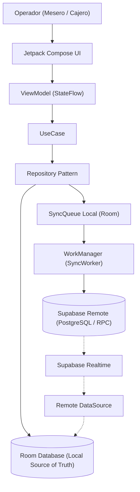

# Exquisssita Manager — Contexto del Proyecto y Especificación Funcional/Visual

> **Documento de Contexto y Especificación de Diseño**  
> Proyecto Android Studio Nativo: `ExquisssitaAppManager`  
> Referencia de Origen: Proyecto Flutter (`exquisssita_manager`)  
> Plataformas Objetivo: Android (Teléfono / Tablet) y Windows Desktop  

---

## 1. Propósito y Alcance del Sistema

**Exquisssita Manager** es una aplicación administrativa y punto de venta (POS) diseñada para operar el servicio continuo de una taquería mexicana contemporánea.

### Perfiles de Usuario Operativos
- **Administrador / Dueño:** Control total del negocio, auditoría, configuración, corte general, altas/bajas de personal y promociones.
- **Gerente:** Supervisión del turno, inventario, autorización de cancelaciones, arqueo y nómina.
- **Cajero:** Cobro de órdenes, división de cuentas, emisión de comprobantes, control de efectivo y corte de caja.
- **Mesero:** Apertura de mesas, comanda activa, pedidos para llevar, agregar productos, solicitar cuenta y liberación física de mesa.
- **Empleado:** Consulta de turno, registro de asistencias y consulta de estatus de nómina.

> [!NOTE]  
> Esta aplicación es **estrictamente administrativa y operativa**. La futura aplicación de clientes (orientada a lealtad, puntos, menú público y recompensas) compartirá el mismo backend de Supabase pero no forma parte de este cliente nativo.

---

## 2. Sistema de Diseño Visual "Operativa Cálida, Flat y Libre de Fricción"

El diseño visual responde a un principio operativo de alto rendimiento en sala y caja, guiado por la directiva de Figma Make y las capturas de pantalla de la interfaz final.

### 2.1 Reglas Estéticas Inmutables
1. **Cero sombras difusas:** Nada de `box-shadow`, elevaciones flotantes con halo difuso o degradados de sombra. Las superficies y tarjetas se distinguen exclusivamente por contraste de color sólido y líneas de borde nítidas de 1 px.
2. **Cero degradados:** Todos los fondos, contenedores, barras y botones son 100% planos (*flat*) y sólidos.
3. **Cero emojis:** Ningún emoji decorativo en botones, estados o títulos. Se utilizan exclusivamente **iconos vectoriales de línea simples (estilo Lucide / Material Symbols Outlined)** en lugares estrictamente necesarios (máximo 1 icono por botón).
4. **Tipografía funcional:** Tipografía sans-serif geométrica limpia (Inter, Plus Jakarta Sans u Outfit) con soporte para **números tabulares (`tnum`)** en todos los precios, cantidades, folios y temporizadores para evitar oscilaciones en pantalla.
5. **Touch Targets generosos:** Mínimo de 48×48 dp en Android para interacción rápida con una mano o durante horas punta.

### 2.2 Paleta de Color Oficial (Tokens Pantone y Hex)

| Muestra Pantone | Nombre del Token | Código Hex | Rol en Modo Claro | Rol en Modo Oscuro |
| :--- | :--- | :--- | :--- | :--- |
| **PANTONE 12-0815 TCX** | `Vanilla Custard` | `#FAF3E0` / `#F5E8C7` | **Fondo principal (Canvas)** y superficies suaves | **Texto principal**, números de saldo y botones invertidos |
| **PANTONE 16-1615 TCX** | `Flamingo Plume` | `#DF8D9B` | **Acento de marca**, botones de acción primaria, badges activos | **Acento luminoso**, botón de cobro y destacados |
| **PANTONE 18-1541 TCX** | `Brandy Brown` | `#7E392F` | **Títulos de sección**, botones de acción destacados (`+ Nueva orden`, `+ Crear promoción`), saldos pendientes, mesa ocupada | **Superficies de acento**, botón secundario, estados de atención |
| **PANTONE 19-1432 TCX** | `Chocolate Fondant` | `#3D2723` | **Texto principal de lectura**, bordes estructurales de 1px | **Fondo de tarjetas elevadas**, acento profundo |
| **PANTONE 14-1120 TCX** | `Apricot Illusion` | `#E5C2A4` | **Superficie de tarjetas**, pastillas de filtro, fondos de inputs | **Texto secundario**, divisores sólidos y badges neutros |
| **PANTONE 19-4024 TCX** | `Dress Blues` | `#252E3A` | Contraste alterno para encabezados y textos estructurados | **Fondo principal (Canvas nocturno)** y estructura base |

#### Tokens de Estado Operativo
- **Mesa Libre / Publicada / En línea:** Verde oliva suave apagado (`#4E7A58` / badge tint `#E3EFE5`).
- **Mesa Ocupada / Saldo Pendiente:** Brandy Brown suave / salmón (`#7E392F` / badge tint `#FCE8E6`).
- **Mesa Reservada / Stock Bajo:** Ocre cálido / ámbar (`#A07324` / badge tint `#FCF3DF`).
- **Sync Sincronizada:** Icono nube suave `#6E7C87`.
- **Sync Pendiente:** Icono refresh ámbar `#A07324`.
- **Sync Error / Rechazado:** Coral ladrillo `#C04D40`.

---

## 3. Arquitectura de Navegación Responsive

La navegación elimina la barra inferior (*Bottom Navigation*) saturada de pestañas, adoptando un esquema de acceso limpio basado en el factor de forma.

```
┌─────────────────────────────────────────────────────────────────────────────┐
│ ESTRATEGIA DE NAVEGACIÓN SEGÚN DISPOSITIVO                                 │
├─────────────────────────────────────────────────────────────────────────────┤
│ 1. MÓVIL (< 600 dp):                                                        │
│    • Top App Bar fija: [ = Menú Drawer ] [ Título ] [ Nube Sync ] [ QR ]   │
│    • NavigationDrawer de pantalla completa con los 10 módulos.             │
│    • Área de contenido scrollable limpia sin barra inferior distractora.    │
├─────────────────────────────────────────────────────────────────────────────┤
│ 2. TABLET (600 a 839 dp):                                                   │
│    • NavigationRail vertical lateral persistente (icono + etiqueta opcional)│
│    • Panel de contenido adaptativo de 2 columnas.                          │
├─────────────────────────────────────────────────────────────────────────────┤
│ 3. WINDOWS / ESCRITORIO (>= 840 dp):                                        │
│    • Sidebar lateral persistente sólida (240 dp) con los 10 módulos.       │
│    • Vista Maestro-Detalle persistente (Salón a la izquierda, comanda a la  │
│      derecha sin transiciones de pantalla).                                 │
└─────────────────────────────────────────────────────────────────────────────┘
```

### Lista Maestra de los 10 Módulos de Navegación:
1. **Inicio / Resumen:** Panel de control diario, turno actual, KPIs y alertas de atención requerida.
2. **Mesas y órdenes:** Mapa de salón, comandas activas y pedidos para llevar.
3. **Menú e inventario:** Catálogo, control de existencias físicas y Kardex de movimientos.
4. **Pagos:** Módulo de cobro, división de cuentas, métodos de pago y cálculo de cambio.
5. **QR y lealtad:** Validación de clientes frecuentes y acumulación de puntos.
6. **Promociones:** Gestión de beneficios vigentes, activación y calendarización.
7. **Empleados y nómina:** Directorio del equipo, días de pago y nómina semanal.
8. **Corte de caja:** Arqueo de turno, desglose de métodos y cierre definitivo.
9. **Reportes:** Estadísticas consolidadas, tendencias de ventas y métricas operativas.
10. **Configuración:** Cuenta, roles, sincronización manual, almacenamiento local y tema.

---

## 4. Jerarquía de Vistas y Estructura de Capas (Stacking Model)

Para evitar la desorientación del personal en horas pico, la interacción se distribuye en tres capas estrictas:

```
┌─────────────────────────────────────────────────────────────────────────┐
│ CAPA 2: Diálogos Modales Centrados (Compactos)                          │
│         Confirmaciones irreversibles y destructivas:                    │
│         • Cancelar orden comisionada                                    │
│         • Cierre definitivo de turno de caja                            │
│         • Alerta de stock insuficiente                                  │
├─────────────────────────────────────────────────────────────────────────┤
│ CAPA 1: Hojas Emergentes de Media Pantalla (Bottom Sheets 60-70% alto)  │
│         Tareas operativas rápidas (< 15 segundos):                      │
│         • Selector táctil de producto para agregar a comanda            │
│         • Hoja de cobro POS (desglose de billetes y cambio)             │
│         • Entrada manual de código QR de cliente                        │
│         • Ajuste rápido de stock de inventario                          │
│         • Registro de pago semanal de empleado                          │
├─────────────────────────────────────────────────────────────────────────┤
│ CAPA 0: Canvas Base (Pantalla Completa o Maestro-Detalle)               │
│         Exploración, listas extensas, mapas de salón y configuración.   │
└─────────────────────────────────────────────────────────────────────────┘
```

---

## 5. Especificación Detallada de Pantallas Basada en Capturas

### 5.1 Pantalla de Inicio / Resumen (Captura 1)
- **Top App Bar:** Botón cuadrado de Menú Hamburguesa `[ = ]`, Título `Inicio / Resumen`, botón cuadrado de estado de sincronización `[ Cloud ]` y botón cuadrado sólido en Brandy Brown con icono de escáner QR `[ QR ]`.
- **Encabezado:** Título `Resumen de hoy` en tipografía sans-serif grande, con subtítulo dinámico: `Miércoles, 21 de agosto • Turno de comida`.
- **Tarjeta de Usuario Activo:**
  - Etiqueta en mayúsculas pequeñas: `USUARIO ACTIVO`.
  - Nombre: `Buen turno, Andrea`.
  - Cargo y sucursal: `Gerente • Sucursal Centro`.
  - Pill de estado: indicador de punto verde con texto `En línea` (verde oliva suave).
  - Información de sincronización: `Última sincronización: 13:42`.
- **Grid de Métricas 2×2 (Tarjetas rectangulares sólidas):**
  - **Ventas del día:** Monto grande en negrita `$18420.00`, con subtítulo `86 operaciones`.
  - **Órdenes abiertas:** Número grande `8`, con desglose `6 mesas • 2 para llevar`.
  - **Mesas ocupadas:** Relación grande `6 / 12`, con porcentaje `50% de ocupación`.
  - **Stock bajo:** Número de alerta `4`, con etiqueta `Requieren atención`.
- **Tarjeta de Atención Requerida (Prioridades operativas del turno):**
  - Subtítulo: `Prioridades operativas del turno`.
  - Ítem 1: Icono tarjeta en caja azul suave | `2 pagos pendientes` (negrita) / `Órdenes listas para cobrar` → Chevron `>`.
  - Ítem 2: Icono caja en contenedor ámbar suave | `4 productos con stock bajo` (negrita) / `Pastor, jamaica, tortillas y aguacate` → Chevron `>`.
  - Ítem 3: Icono personas en contenedor azul suave | `Pago semanal para 2 empleados` (negrita) / `Vence hoy • $6000.00` → Chevron `>`.

### 5.2 Pantalla de Mesas y Órdenes (Captura 2)
- **Encabezado de Página:** Título `Mesas y órdenes`, subtítulo `Estado del salón en tiempo real`, y botón principal a la derecha `+ Nueva orden` en fondo sólido Brandy Brown `#7E392F` con texto blanco.
- **Pestañas de Navegación:** Pestaña activa con línea inferior en Brandy Brown: `Mesas` frente a `Para llevar` con badge numérico `2`.
- **Filtros por Estado (Chips planos):**
  - `Todas` (seleccionada con fondo Apricot Illusion `#E5C2A4`).
  - `Libres` (borde sólido, sin relleno).
  - `Ocupadas` (borde sólido, sin relleno).
  - `Reservadas` (borde sólido, sin relleno).
- **Cuadrícula de Mesas (Grid 2 columnas en móvil / 4 columnas en tablet/desktop):**
  - **Mesa Ocupada (ej. Mesa 01):** Borde sutil salmón/rojizo, cabecera con número `Mesa 01` y pastilla `Ocupada` (punto rojo + fondo salmón), precio acumulado grande `$285.00`, tiempo transcurrido y mesero `18 min • Carlos`, y estado de sincronización local en el pie: icono de nube con texto `Sincronizada`.
  - **Mesa Libre (ej. Mesa 02):** Borde sutil verde, cabecera `Mesa 02` y pastilla `Libre` (punto verde + fondo verde claro), texto grande `Disponible`, subtítulo `Lista para abrir orden`, pie con icono de nube `Sincronizada`. Tap directo abre modal de nueva comanda.
  - **Mesa Reservada (ej. Mesa 03):** Borde sutil ámbar, cabecera `Mesa 03` y pastilla `Reservada` (punto ámbar + fondo amarillo suave), hora grande `14:30`, subtítulo `Responsable: Daniela`, pie `Sincronizada`.
  - **Mesa con Sync Local Pendiente (ej. Mesa 04):** Borde salmón, `Mesa 04`, badge `Ocupada`, `$460.00`, `34 min • Carlos`, y en el pie: icono de actualización ámbar con texto `Pendiente` (indica operación guardada en Room esperando envío a Supabase).

### 5.3 Pantalla de Pagos y División de Cuentas (Captura 3)
- **Encabezado y Contexto:** Título `Pagos`, breadcrumb superior: `Mesa 01 • Orden #1842`.
- **Tarjeta 1: Productos Seleccionados (División de Cuenta):**
  - Título `Productos seleccionados`, subtítulo `Selecciona productos para dividir la cuenta`.
  - Acción rápida superior derecha en texto Brandy Brown: `Seleccionar todos`.
  - Lista de ítems con Checkbox cuadrado en color Brandy Brown:
    - `[x] 4 × Taco al pastor` — `$112.00` (Estado: `Pendiente`)
    - `[x] 2 × Taco de barbacoa` — `$64.00` (Estado: `Pendiente`)
    - `[x] 1 × Agua de jamaica` — `$35.00` (Estado: `Pendiente`)
    - `[x] 1 × Guacamole` — `$74.00` (Estado: `Pendiente`)
  - Recuadro inferior dentro de la tarjeta con tinte suave Apricot Illusion:  
    `Productos ya pagados: Aún no hay productos pagados en esta orden.` (Cuando existen pagos parciales previos, muestra la lista de ítems cubiertos en transacciones anteriores).
- **Tarjeta 2: Resumen de Pago:**
  - `Total de la orden:` `$285.00`
  - Línea divisoria sólida de 1 px.
  - `Total pagado:` `$0.00`
  - Línea divisoria sólida de 1 px.
  - `Total pendiente:` `$285.00` (en tipografía prominente Brandy Brown `#7E392F`).
  - Selector de método de pago: Campo de selección con etiqueta `Método de pago` y valor `Efectivo v`.
  - Campo numérico inferior: `Monto recibido`.

### 5.4 Pantalla de Promociones (Captura 4)
- **Encabezado de Página:** Título `Promociones`, subtítulo `Publicación y vigencia de beneficios`, y botón a la derecha `+ Crear promoción` en fondo sólido Brandy Brown `#7E392F`.
- **Pestañas de Estado con Contadores:**
  - `Activas` (badge `3`, subrayado activo en Brandy Brown).
  - `Inactivas` (badge `2`).
  - `Vencidas` (badge `6`).
- **Lista de Tarjetas de Promoción:**
  - Cada tarjeta contiene:
    - Icono de etiqueta de descuento en contenedor cuadrado Apricot Illusion `#E5C2A4`.
    - Pastilla de estado verde suave: punto verde + `Publicada`.
    - Título de la promoción (ej. `Martes de tacos`, `Combo comida completa`, `Visita frecuente`).
    - Descripción de la oferta (ej. `2 × 1 en tacos seleccionados`, `10 tacos, bebida y complemento`).
    - Rango de vigencia: `Publicada: 12 ago. - Vence: 30 sep.`.
    - Fila de acciones: Botón contorneado con icono de lápiz `Editar` y botón en texto Brandy Brown `Despublicar`.

---

## 6. Reglas de Negocio Críticas

### 6.1 Manejo de Dinero y Precisión Financiera
- **Cero uso de tipos flotantes (`Double` / `Float`):** Todos los cálculos monetarios se realizan en **centavos enteros de 64 bits (`Long`)**.
- En la interfaz de usuario se capturan pesos y centavos (ej. `$35.50`), pero se transforman de inmediato a `3550L` centavos.
- Room almacena `BIGINT` (en Kotlin `Long`) y Supabase almacena `BIGINT`.
- Todas las operaciones de suma, resta y prorrateo se calculan en centavos exactos para evitar discrepancias por redondeo.

### 6.2 Liberación Manual de Mesas tras el Pago
> [!IMPORTANT]  
> **Regla de Restaurante:** Cuando una orden se liquida por completo (`total_pagado_cents == total_cents`), la mesa **NO se libera automáticamente**. En la operación diaria, los comensales suelen permanecer conversando en la mesa tras pagar la cuenta. La mesa debe pasar a un estado visual "Pagada / Esperando liberación" y es el mesero o cajero quien debe presionar explícitamente la acción **"Liberar Mesa"** para dejarla disponible para nuevos clientes.

### 6.3 Control Atómico de Inventario y Kardex
- Está estrictamente prohibido mutar directamente la columna `stock_actual` sin un registro auditable.
- Cada modificación genera un registro inmutable en `movimientos_inventario`:
  - `entrada`: Abastecimiento de insumos.
  - `venta`: Consumo derivado del cierre de un ítem de orden.
  - `ajuste`: Corrección física de conteo en almacén.
  - `merma`: Producto dañado, caducado o caído.
  - `cancelacion`: Reversión de comanda cancelada.
- Los productos sin inventario limitado (ej. tacos preparados al momento) tienen `controla_stock = false` y no bloquean la comanda. Los productos controlados (refrescos, cervezas, postres empaquetados) impiden venta si `stock_actual <= 0` o generan alerta si `stock_actual <= stock_minimo`.

### 6.4 Nómina Semanal Operativa
- La nómina se calcula con base en una semana estándar (Lunes = 1 a Domingo = 7).
- La pantalla principal y el módulo de nómina evalúan en tiempo real el día de la semana actual:
  > *"Hoy corresponde pagar a [N] empleados"*
- Los registros de pago en `historial_pagos_empleados` son *append-only*.
- Una restricción de clave de idempotencia impide pagar dos veces al mismo empleado en el mismo periodo semanal.

### 6.5 Fidelización y Escáner QR de Clientes
- Cada cliente dispone de un identificador QR único.
- El flujo de escaneo valida el formato, verifica la existencia del cliente y registra la visita en `visitas_clientes`.
- **Regla de Frecuencia:** Existe una restricción `UNIQUE(cliente_id, fecha_visita)` a nivel de base de datos para impedir duplicidad accidental de puntos en un mismo día.

### 6.6 Corte y Arqueo de Caja
- El arqueo agrupa transacciones por método de pago (`efectivo`, `tarjeta`, `transferencia`).
- No se eliminan transacciones históricas para cuadrar la caja.
- El cierre de caja registra fecha/hora exacta, monto esperado en sistema, monto real ingresado por el cajero y la diferencia (sobrante/faltante).

---

## 7. Arquitectura Offline-First y Fuente de Verdad



1. **La interfaz de usuario lee exclusivamente de Room:** Toda pantalla se alimenta mediante `Flow` reactivo desde los DAOs locales. La UI nunca espera una llamada de red a Supabase para responder a un toque del usuario.
2. **Las escrituras son locales e inmediatas:** Cada acción genera un registro local en Room y una tarea en la cola `sync_queue`.
3. **Sincronización robusta en segundo plano:** WorkManager procesa la cola con idempotencia (`UUID v4`), backoff exponencial y clasificación de fallos temporales vs fallos permanentes que requieren revisión manual.
